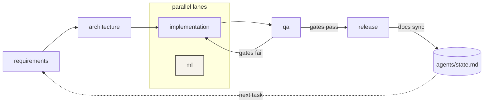

# Agent graph — how this repo is built

PocketLedger is developed by role agents that hand off artifacts to each other.
The graph is the contract: each node has a mission, required inputs, produced
artifacts, and an exit gate. Any agent session (human-driven or automated) must
locate itself in this graph before writing code.



## Nodes

| Node | Role file | Mission | Exit gate |
|---|---|---|---|
| Orchestrator | [`roles/orchestrator.md`](roles/orchestrator.md) | Keep `state.md` truthful, pick the next task, sequence/parallelise agents | Board updated; task has owner + acceptance |
| Requirements | [`roles/requirements.md`](roles/requirements.md) | Turn user intent into testable requirements; maintain `requirements.md` | Every feature has rules, flows, acceptance criteria |
| Architecture | [`roles/architecture.md`](roles/architecture.md) | Shape modules, data flow, invariants; approve dependencies | Plan names files/APIs + risks; invariants intact |
| Implementation | [`roles/implementation.md`](roles/implementation.md) | Write code/UI per plan, keep the design language | Builds clean; unit tests added; no invariant broken |
| QA | [`roles/qa.md`](roles/qa.md) | Prove behavior on the emulator + gates | `testDebugUnitTest` + `connectedDebugAndroidTest` green; regressions mapped |
| Release | [`roles/release.md`](roles/release.md) | Tag, flash, document, sync state | Tag pushed; APK on device; docs/state updated |

## Handoff protocol

Each handoff is a short packet in the PR/commit description or `state.md`:

```
FROM: <node>  TO: <node>
GOAL: <one sentence>
CONTEXT: <files / requirements ids>
DONE WHEN: <measurable gate>
RISKS: <known traps>
```

Rules:

- **Requirements never jumps to release.** Behavior must pass QA on a device.
- **QA can reject back to implementation** with the failing test + device evidence.
- **Parallelism:** implementation (UI/logic) and ml lanes may run concurrently only
  when they touch disjoint files. Anything touching `SmsPipeline` or the schema is
  sequential.
- **No silent scope:** if reality contradicts a requirement, go back to requirements
  and update the doc before coding.

## Definition of done (all nodes)

1. Behavior covered by a test (unit and/or `testing/` E2E) that failed before / passes after.
2. `./gradlew :app:testDebugUnitTest` green.
3. If UI changed: E2E flow updated or added; screenshot refreshed in `docs/`.
4. `agents/state.md` updated (status, evidence links).
5. Invariants in root `AGENTS.md` untouched (no INTERNET, Long money, ML gates).
6. Committed with Conventional Commit + version tag when it ships.

## Artifact ownership

| Artifact | Owner |
|---|---|
| `agents/requirements.md`, flows | requirements |
| `agents/roles/architecture.md` decisions log | architecture |
| `app/src/main`, `app/src/test`, resources | implementation |
| `testing/`, QA evidence, device matrix | qa |
| Tags, release notes, APK installs | release |
| `agents/state.md` | orchestrator (everyone may append evidence) |
